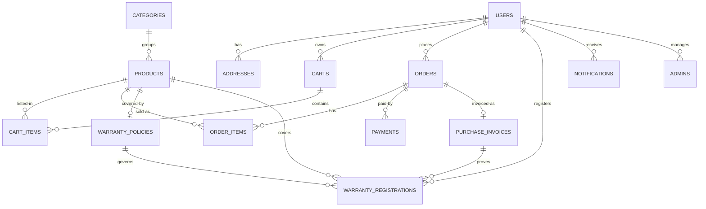

# ER Diagram (3NF)

Keys: all tables use integer PK `id`. Money uses `NUMERIC(12,2)`.
Unique: `users.email`, `admins.email`, `products.model_number`,
`orders.order_number`, `payments.transaction_id`, `purchase_invoices.invoice_number`,
`warranty_registrations.warranty_number`,
`(warranty_registrations.product_id, serial_number)`.
